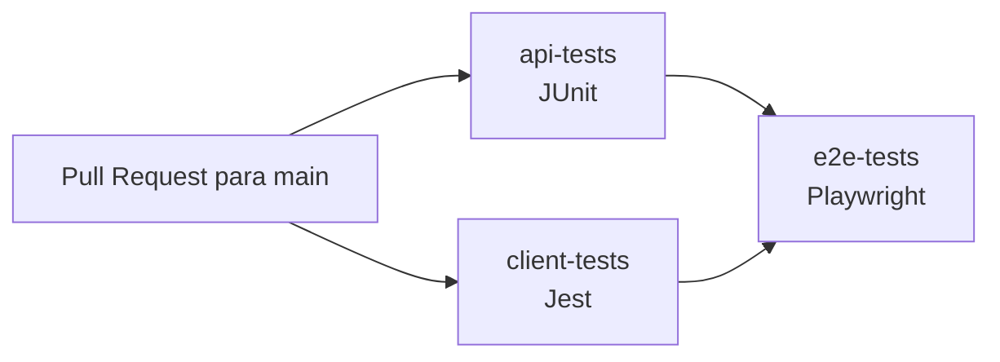

# SQA Social Media

Projeto educacional com uma API Spring Boot e um frontend Next.js.

## Visão Geral

- `api/`: backend Java 17 com Spring Boot, autenticação, usuários, posts e curtidas.
- `client/`: frontend Next.js/React que consome a API.
- `tests/`: testes E2E e de API (caixa-preta) com Playwright.

Principais rotas da aplicação:

- Frontend: `http://localhost:3000`
- API: `http://localhost:8080`

## Como Rodar

Pré-requisitos:

- Java 17+
- Node.js 18+
- npm
- MySQL configurado para o ambiente de desenvolvimento

API:

```bash
cd api
./mvnw spring-boot:run
```

Frontend:

```bash
cd client
npm install
npm run dev
```

O frontend usa `NEXT_PUBLIC_BASE_URL` para definir a URL da API. Exemplo de `.env` em `client/`:

```env
NEXT_PUBLIC_BASE_URL=http://localhost:8080
```

## Testes Automatizados

| Suíte | Tipo | Ferramenta | Como rodar |
| ----- | ---- | ---------- | ---------- |
| `api/src/test` | Caixa-branca (unidade e integração) | JUnit 5, Mockito, MockMvc, H2 | `cd api && ./mvnw test` |
| `client/tests` | Caixa-branca (unidade e integração) | Jest, Testing Library | `cd client && npm test` |
| `tests/specs` | Caixa-preta (E2E e API) | Playwright | `cd tests && npm test` |

### Bugs conhecidos

Os testes que documentam bugs encontrados nas atividades anteriores descrevem o **comportamento correto** e são marcados como falha esperada, para que a suíte continue verde sem esconder o problema:

| Suíte | Marcação |
| ----- | -------- |
| JUnit | `@KnownBug("descrição")` (`api/src/test/java/com/demoapp/demo/support`) |
| Jest | `test.failing(...)` |
| Playwright | `test.fail(...)` |

O teste marcado continua sendo executado. Enquanto o bug existir, ele falha e é contado como sucesso; se o bug for corrigido, o teste passa e a suíte **quebra**, avisando que a marcação deve ser removida para que ele vire um teste de regressão comum. No JUnit, a anotação também aplica a tag `known-bug`, permitindo filtrar esses testes (`./mvnw test -Dgroups=known-bug`).

## Integração Contínua (GitHub Actions)

A esteira fica em [`.github/workflows/ci.yml`](.github/workflows/ci.yml) e é disparada sempre que um Pull Request com destino à `main` é aberto, reaberto ou recebe novos commits (também pode ser executada manualmente pela aba **Actions**).



| Job | Ambiente | O que faz |
| --- | -------- | --------- |
| `api-tests` | Java 17 (Temurin) + cache do Maven | Instala as dependências e executa os testes JUnit (banco H2 em memória) |
| `client-tests` | Node.js 22 + cache do npm | Instala as dependências com `npm ci` e executa os testes Jest com cobertura |
| `e2e-tests` | Java 17, Node.js 22, MySQL 8.4 (service container) e Chromium | Gera o pacote da API e o build de produção do cliente, inicia os dois servidores, aguarda ficarem disponíveis, verifica os tipos e executa a suíte Playwright |

O job `e2e-tests` só roda se os testes de unidade e integração passarem. A API é iniciada com o perfil padrão apontando para o MySQL do service container por meio das variáveis `SPRING_DATASOURCE_*`, sem alterar nenhum arquivo de configuração.

Os relatórios ficam disponíveis como artefatos de cada execução: `api-surefire-reports`, `client-coverage`, `playwright-report` e `server-logs`.

## Fluxo de Trabalho

1. Crie uma branch a partir da `main` (`feature/...`, `fix/...`, `test/...`, `ci/...`).
2. Abra um Pull Request para a `main`.
3. A esteira de CI roda automaticamente; o PR só deve ser integrado com todos os jobs verdes.

## Documentações

- [README da API](api/README.md)
- [README do Frontend](client/README.md)
- [README dos Testes E2E e de API](tests/README.md)
- [DummyJSON API Docs](https://dummyjson.com/docs)
